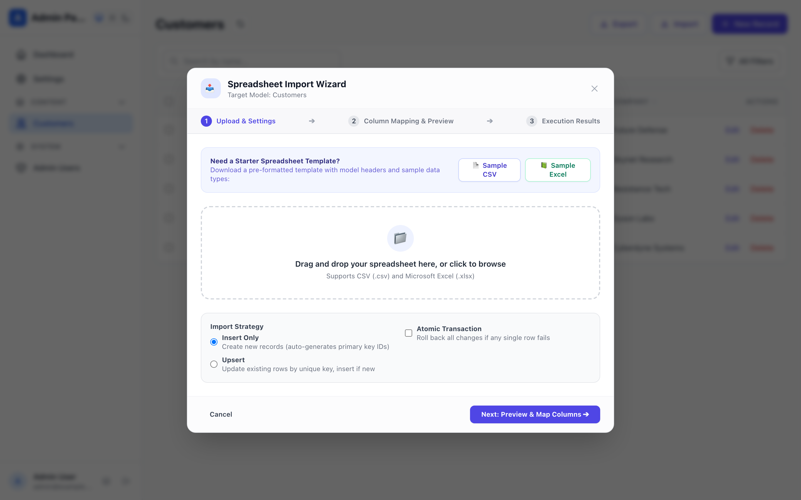
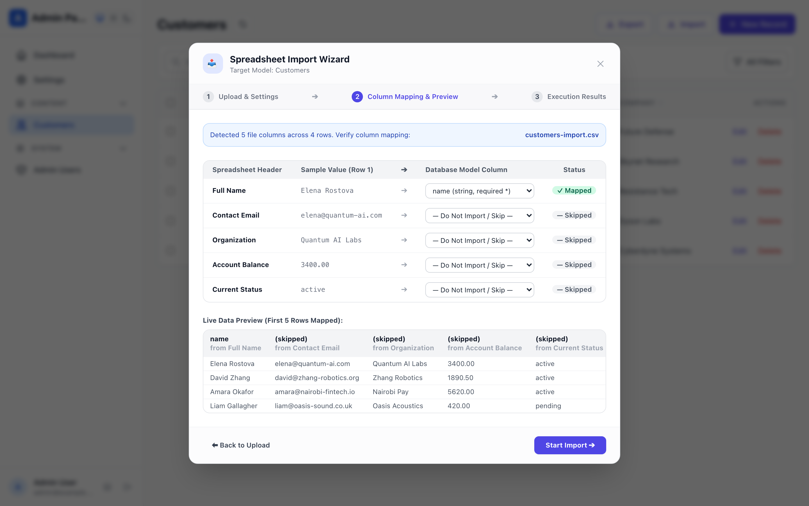
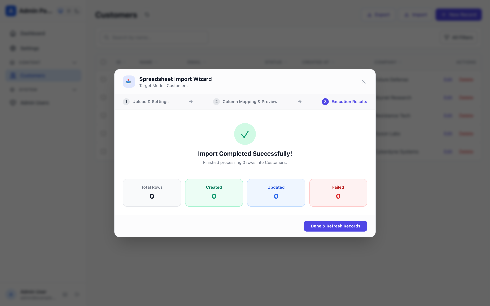
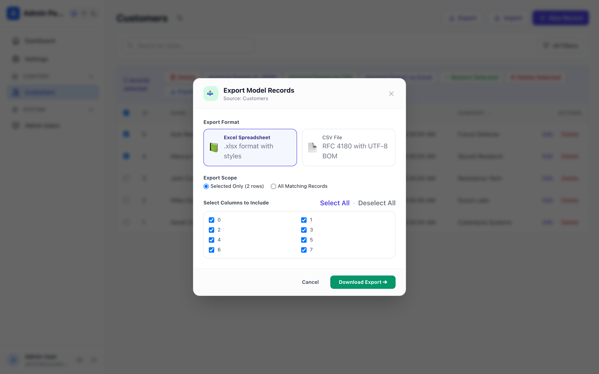

# Data Exchange Suite (Import & Export Wizard) Guide

Webspresso includes a high-performance **Data Exchange Suite** (`dataExchangePlugin`) for bulk importing and exporting ORM model records via Microsoft Excel (`.xlsx`) and RFC 4180 CSV files. It combines automated spreadsheet template generation, heuristic column mapping, atomic transaction guarantees, and an interactive 3-step visual wizard inside the Mithril.js Admin Panel.

---

## 1. Quick Setup & Configuration

Register `dataExchangePlugin` inside `createApp({ plugins: [...] })`:

```javascript
const { createApp, createDatabase, adminPanelPlugin, dataExchangePlugin } = require('webspresso');

const db = createDatabase(require('./webspresso.db'));

const { app } = createApp({
  db,
  plugins: [
    adminPanelPlugin({ db }),
    dataExchangePlugin({
      db,
      adminPath: '/_admin',
      maxFileBytes: 10 * 1024 * 1024, // 10 MB upload ceiling
    }),
  ],
});
```

### Plugin Configuration Options

| Option | Type | Default | Description |
| :--- | :--- | :--- | :--- |
| `db` | `Object` | `null` | Knex database instance holding model registries and connection pool. |
| `adminPath` | `string` | `'/_admin'` | Mount path of the Webspresso Admin Panel SPA. |
| `maxFileBytes` | `number` | `10485760` (10MB) | Maximum spreadsheet upload payload size before rejection. |
| `maxPreviewRows` | `number` | `10` | Maximum sample rows returned in the preview analyzer payload. |

---

## 2. Admin Management SPA & Visual Features

Every ORM model registered in the Admin Panel automatically gains native **Export** and **Import** actions on its list view header toolbar and bulk selection bar.

### 📥 3-Step Spreadsheet Import Wizard

#### Step 1: Upload & Starter Templates
Upload an existing spreadsheet or immediately download a ready-to-fill sample template generated specifically from the model's schema:
- **Starter Template Downloads:** 1-click generation of formatted `.csv` (with UTF-8 BOM for Microsoft Excel) and `.xlsx` templates containing column definitions and sample typed data.
- **Drag-and-Drop Dropzone:** Intuitive dropzone accepting `.csv` and `.xlsx` files with instant client-side size verification.
- **Import Strategy:** Choose between **Insert Only** (creates new records with auto-increment IDs) and **Upsert** (matches existing records by unique primary key or foreign key).
- **Atomic Transactions Checkbox:** When enabled, the entire import runs inside a single database transaction. If any row fails validation or constraint checks, the entire batch rolls back completely.


*Fig 1: Step 1 of the Import Wizard showing pre-formatted template download buttons, dropzone, and import strategies.*

---

#### Step 2: Visual Column Mapping & Live Preview
Before any data is written to the database, the analyzer parses file headers and matches them against model column names:
- **Heuristic Column Matching:** Automatically matches exact matches, case-insensitive headers, normalized alphanumeric names (`"Full Name"` ➔ `full_name`), and common semantic aliases (`"E-Mail"` ➔ `email`, `"Amount"` ➔ `price`, `"Qty"` ➔ `quantity`).
- **Interactive Mapping Selectors:** Review each file header with a sample value from Row 1, and select the corresponding model column or choose `— Do Not Import / Skip —`.
- **Status Badges:** Clear visual indicators displaying `✓ Mapped` or `— Skipped` for each spreadsheet column.
- **Live Data Preview:** Scrollable preview table showing the first 5 rows with mapped column headers before committing.


*Fig 2: Step 2 of the Import Wizard displaying suggested column mapping dropdowns and live sample data table.*

---

#### Step 3: Execution Results & Row-by-Row Diagnostics
Upon clicking **Start Import**, the wizard streams the batch to the server and displays an interactive execution report:
- **Results KPI Banner:** Real-time counts for **Total Rows**, **Created**, **Updated**, and **Failed**.
- **Detailed Error Inspection Table:** If any rows fail (due to type mismatches, unique key collisions, or missing required fields), inspect the exact spreadsheet row number, offending column, received value, and descriptive error message.


*Fig 3: Step 3 of the Import Wizard showing success KPI summary card and row-by-row error diagnostics.*

---

### 📤 Spreadsheet Export Wizard

The Export Wizard allows staff to export records in either Microsoft Excel (`.xlsx`) or RFC 4180 CSV (`.csv`) with customized field subsets:
- **Format Cards:** Visual selection between rich Excel spreadsheets (with bold headers and auto-column width calculation) and clean CSV files.
- **Scope Selection:** Export either **All Matching Records** (honoring active table filters and soft-delete states) or **Selected Only** (exporting checked rows).
- **Column Checklist:** Granularly toggle individual columns to include in the exported file, with instant **Select All** and **Deselect All** helpers.


*Fig 4: Export Wizard modal showing format cards, scope selection, and column checkbox toggles.*

---

## 3. Built-in Services API

The Data Exchange suite exposes four declarative services registered in the Webspresso Service Registry (`core/services`):

### `exchange.template`
Generates a downloadable starter spreadsheet template buffer for an ORM model:

```javascript
const result = await ctx.service('exchange.template', {
  model: 'Customer',
  format: 'xlsx', // 'xlsx' | 'csv'
  mode: 'insert', // 'insert' | 'upsert'
});

// result.buffer -> Buffer
// result.filename -> 'Customer-template.xlsx'
// result.contentType -> 'application/vnd.openxmlformats-officedocument.spreadsheetml.sheet'
```

### `exchange.preview`
Analyzes a file buffer and returns header structure, sample rows, and suggested model mappings:

```javascript
const preview = await ctx.service('exchange.preview', {
  model: 'Customer',
  buffer: fileBuffer,
  filename: 'uploaded-customers.csv',
  maxPreviewRows: 10,
});

// preview.fileHeaders -> ['Full Name', 'Email', 'Balance']
// preview.suggestedMapping -> { 'Full Name': 'name', 'Email': 'email', 'Balance': 'balance' }
// preview.sampleRows -> [['John Doe', 'john@example.com', '150.00']]
```

### `exchange.export`
Exports model records into a formatted buffer with optional column filtering and ID scoping:

```javascript
const exportResult = await ctx.service('exchange.export', {
  model: 'Customer',
  format: 'xlsx', // 'xlsx' | 'csv'
  columns: ['name', 'email', 'balance'],
  selectAll: true,
  filters: { status: 'active' },
});

// exportResult.buffer -> Buffer
// exportResult.filename -> 'Customer_export.xlsx'
```

### `exchange.import`
Imports spreadsheet rows into a model repository with optional column mapping and atomic transactions:

```javascript
const importResult = await ctx.service('exchange.import', {
  model: 'Customer',
  buffer: fileBuffer,
  filename: 'incoming.xlsx',
  mode: 'upsert', // 'insert' | 'upsert'
  upsertKey: 'email',
  atomic: true, // roll back all rows if any single row fails
  columnMapping: {
    'Customer Name': 'name',
    'Contact Email': 'email',
    'Current Balance': 'balance',
  },
});

// importResult.created -> 14
// importResult.updated -> 3
// importResult.failed -> 0
```

---

## 4. REST API Endpoint Reference

All endpoints are protected by the Admin Panel session middleware and mounted under `/_admin/api/data-exchange`:

| Method | Endpoint | Description |
| :--- | :--- | :--- |
| `GET` | `/_admin/api/data-exchange/template/:model` | Returns starter CSV or Excel template file with sample row. Accepts `?format=csv\|xlsx&mode=insert\|upsert`. |
| `POST` | `/_admin/api/data-exchange/preview/:model` | Analyzes uploaded multipart spreadsheet without persisting and returns headers, sample rows, and suggested mappings. |
| `GET` | `/_admin/api/data-exchange/export/:model` | Exports records as download stream. Accepts query params: `format`, `columns`, `ids`, `filters`. |
| `POST` | `/_admin/api/data-exchange/export/:model` | Exports records with JSON body filter payload: `{ format, columns, selectAll, ids, filters }`. |
| `POST` | `/_admin/api/data-exchange/import/:model` | Imports records from multipart `file`. Accepts `mode`, `upsertKey`, `atomic`, and `columnMapping`. |

---

## 5. Architectural Guarantees & Best Practices

1. **Zero External Runtime Dependencies for Core**: The Data Exchange plugin relies on native Node.js streams, buffers, and string encoders, using `exceljs` and `csv-parse` solely for spreadsheet serialization.
2. **Formula Injection Sanitization**: All exported CSV text cells starting with formula triggers (`=`, `+`, `-`, `@`, `\t`, `\r`) are automatically escaped to prevent CSV injection attacks in spreadsheet viewers.
3. **UTF-8 BOM Compatibility**: CSV exports and starter templates include the `\uFEFF` Unicode Byte Order Mark, ensuring accented international characters display cleanly in Microsoft Excel without manual encoding selection.
4. **Soft-Delete Scoping**: Exports automatically respect model soft-delete scopes (`deleted_at`), excluding deleted records by default or exporting only trashed rows when the `Trash` view tab is active.
5. **Atomic Isolation**: With `atomic=true`, multi-thousand row batches run within a nested database transaction. If validation fails on row 999, rows 1 through 998 are guaranteed not to leave orphaned or partially written records.
