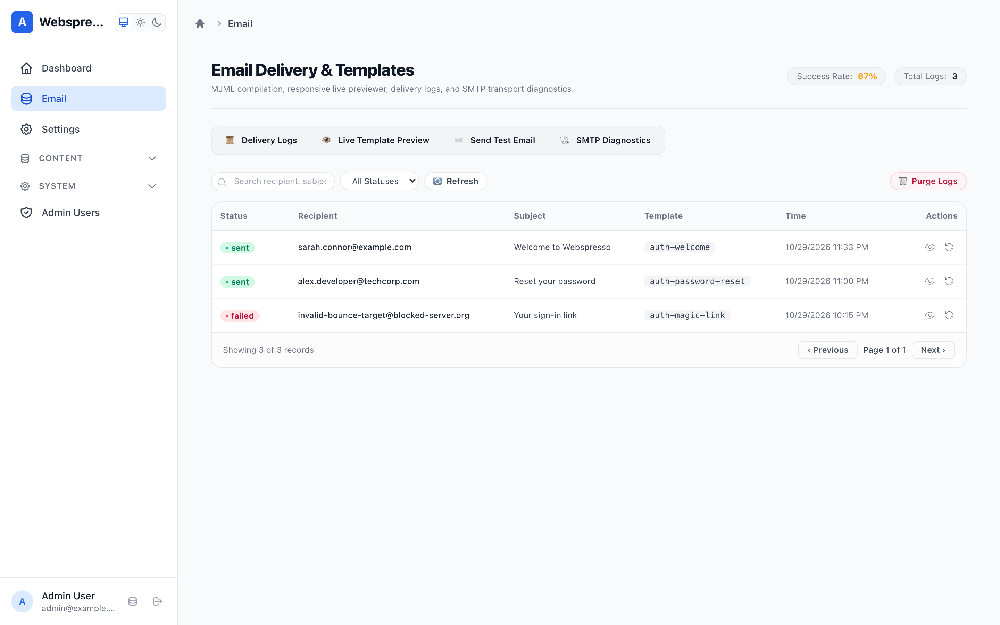
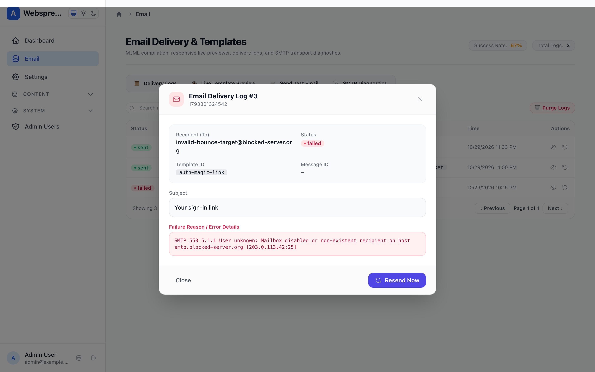
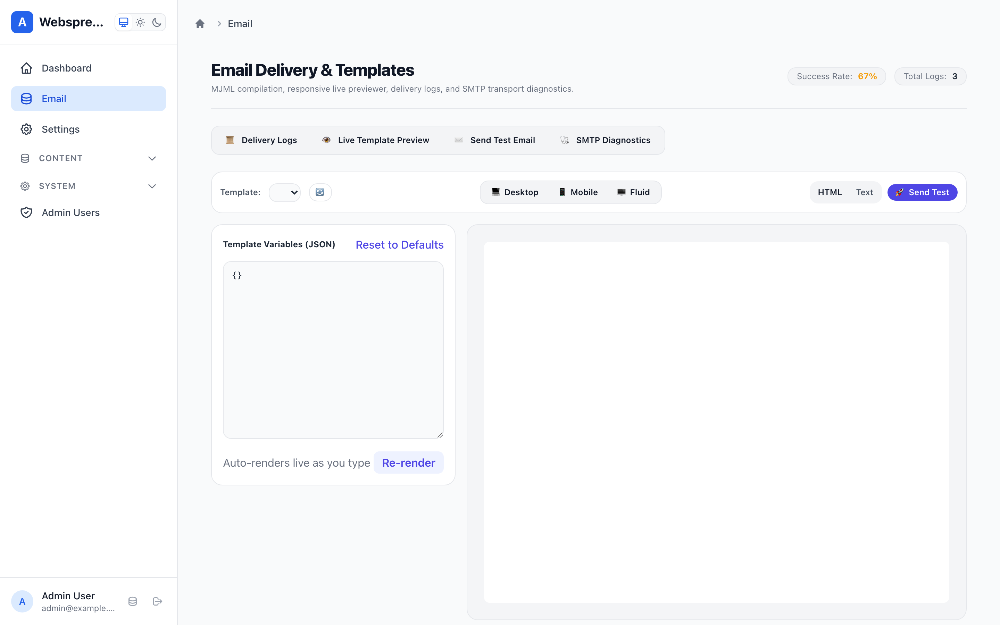
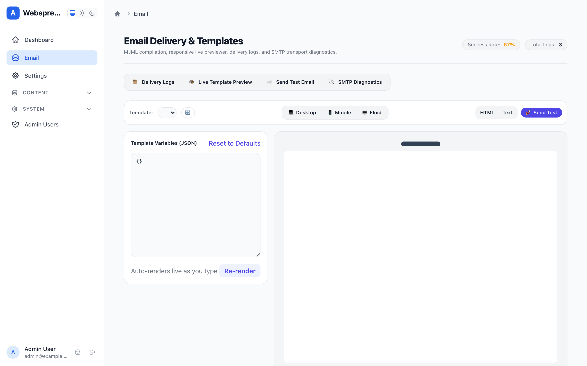
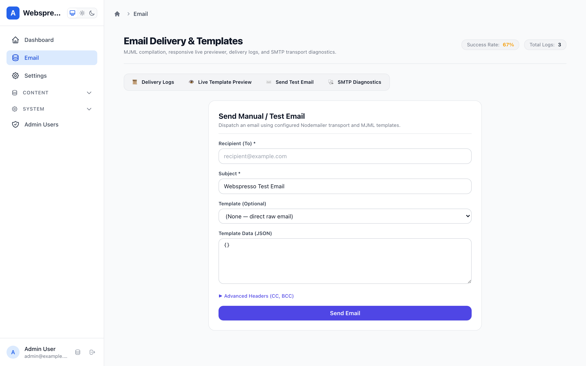
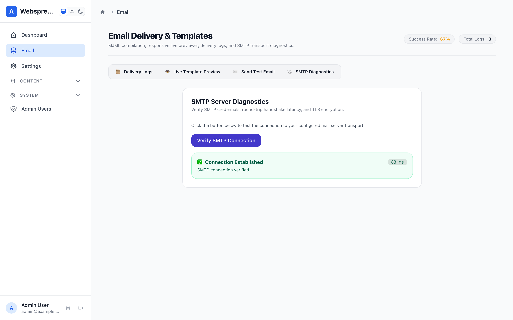

# Email Suite & Delivery Engine Guide

Webspresso includes a production-grade, zero-external-dependency **Email Suite & Delivery Engine** (`emailPlugin`). It provides responsive MJML template compilation, pluggable delivery backends, transactional audit logging, automated retention cleanup, and an enterprise Mithril.js Admin Panel SPA at `/_admin#!/email`.

---

## 1. Quick Setup & Configuration

Register `emailPlugin` inside `createApp({ plugins: [...] })`:

```javascript
const { createApp, createDatabase, adminPanelPlugin, emailPlugin } = require('webspresso');

const db = createDatabase(require('./webspresso.db'));

const { app } = createApp({
  db,
  plugins: [
    adminPanelPlugin({ db }),
    emailPlugin({
      db,
      backend: process.env.NODE_ENV === 'production' ? 'smtp' : 'memory',
      smtp: {
        host: process.env.SMTP_HOST || 'smtp.mailtrap.io',
        port: Number(process.env.SMTP_PORT) || 2525,
        auth: {
          user: process.env.SMTP_USER,
          pass: process.env.SMTP_PASS,
        },
      },
      defaults: {
        from: 'Webspresso App <noreply@myapp.com>',
      },
      templatesDir: './emails',
      logToDb: true,
      tableName: 'email_logs',
      retentionDays: 90,
      autoCleanup: true,
      includeAdminPage: true,
    }),
  ],
});
```

### Plugin Configuration Options

| Option | Type | Default | Description |
| :--- | :--- | :--- | :--- |
| `backend` | `'smtp' \| 'memory' \| 'console' \| 'file'` | `'memory'` | Email transport strategy. |
| `db` | `Object` | `null` | Knex database instance for delivery logging. |
| `transport` | `Object` | `null` | Pre-configured custom Nodemailer transport instance. |
| `smtp` | `Object` | `null` | SMTP connection settings `{ host, port, auth, secure }`. |
| `defaults` | `Object` | `{}` | Default headers applied to outgoing emails (`from`, `replyTo`). |
| `templatesDir` | `string` | `null` | Path to directory containing `.mjml` templates. |
| `templates` | `Object` | `{}` | In-memory map of template strings `{ name: '<mjml>...' }`. |
| `logToDb` | `boolean` | `true` | Persist dispatch records and errors into database. |
| `tableName` | `string` | `'email_logs'` | Table name used for delivery history. |
| `retentionDays` | `number` | `90` | Days to retain email log entries before scheduled cleanup. |
| `autoCleanup` | `boolean` | `true` | Run background timer to purge expired delivery records. |
| `includeAdminPage` | `boolean` | `true` | Mount Email Management UI in Admin Panel at `/_admin/email`. |
| `devInbox` | `boolean` | `false` | Enable developer web inbox at `/_webspresso/mail-preview`. |

---

## 2. Admin Management SPA & Visual Features

Mounted inside the Admin Panel at `/_admin#!/email`, the management suite provides four dedicated workspaces:

### 📊 Delivery Audit Logs & Real-Time Search
Every outgoing email is audited with its recipient, subject, template ID, delivery status (`sent` or `failed`), and completion timestamp:
- **Metrics Summary Banner:** Instant visibility into total volume, successful dispatches, and percentage success rate.
- **Debounced Live Search:** Fast in-memory/SQL filtering across recipients (`to`), subject lines, and template names.
- **Status Filter:** Toggle between `All`, `Sent`, and `Failed` delivery states.
- **Detailed Log Modal:** Inspect full JSON metadata, request headers, and error tracebacks for failed attempts.
- **1-Click Retry / Resend:** Resend failed messages or duplicate sent messages directly from the log table.


*Fig 1: Delivery logs dashboard with metrics banner, search bar, and 1-click retry button.*


*Fig 2: Failure diagnostics modal displaying error message, stack trace, and delivery metadata.*

---

### 📱 Live Responsive Template Previewer
Preview transactional MJML templates before deploying to production without leaving the Admin Panel:
- **Responsive Viewport Toggles:** Switch between **Desktop** (`680px`), **Mobile** (`375px` phone bezel), and **Fluid** (`100%`) viewport widths.
- **HTML vs Plain Text Tabs:** Verify both rich HTML styling and fallback text versions.
- **Sample JSON Editor:** Edit interpolation variables live with instant hot-reloading in the sandbox iframe.
- **Quick Send Test:** Dispatch the currently previewed template directly to an email address with one click.


*Fig 3: Desktop template preview with interactive JSON variable editor.*


*Fig 4: Mobile preview enclosed in a realistic smartphone bezel.*

---

### ✉️ Manual Test Sender
Send test emails with custom HTML or raw plain text to verify inbox placement and formatting:
- **Flexible Addressing:** Configure `To`, `Subject`, `From`, `Reply-To`, `CC`, and `BCC` fields.
- **Format Toggle:** Send pure HTML or plain text messages.
- **Instant Feedback:** Displays clear success badges and detailed error notifications.


*Fig 5: Manual test email dispatch interface with collapsible CC/BCC inputs.*

---

### 🔌 Live SMTP Diagnostics & Connection Testing
Diagnose connection issues with your email delivery provider without sending a message:
- **Handshake Verification:** Executes SMTP `verify()` handshake against the configured host.
- **Round-Trip Latency:** Measures and displays exact connection latency in milliseconds (`ms`).
- **Connection Details:** Reports active transport backend, host, and port.


*Fig 6: Transport verification showing active connection status and latency.*

---

## 3. Programmatic Usage & Services Layer

### Built-in Services

Webspresso registers standardized built-in services for email operations, accessible via `ctx.service()` or `req.service()`:

```javascript
// 1. Send an email or compiled template
const result = await ctx.service('mail.send', {
  to: 'customer@example.com',
  subject: 'Welcome to our platform',
  template: 'welcome',
  data: { name: 'Ahmet' },
});

// 2. Render template preview
const preview = await ctx.service('mail.preview', {
  template: 'welcome',
  data: { name: 'Ahmet' },
});

// 3. Inspect delivery log by ID
const log = await ctx.service('mail.get-log', { id: 42 });

// 4. Retry / resend a previous delivery log
const resendResult = await ctx.service('mail.resend', {
  id: 42,
  to: 'new-email@example.com', // optional override
});

// 5. Verify transport connectivity
const isHealthy = await ctx.service('mail.verify');
```

---

## 4. Declarative `Mailable` Classes

Encapsulate email logic into clean, reusable class definitions:

```javascript
const { Mailable } = require('webspresso');

class WelcomeEmail extends Mailable {
  constructor(user) {
    super();
    this.user = user;
  }

  build() {
    this.to(this.user.email, this.user.name)
      .from('team@myapp.com', 'Webspresso Team')
      .subject(`Welcome to Webspresso, ${this.user.name}!`)
      .view('welcome', { user: this.user })
      .attach({
        filename: 'welcome-guide.pdf',
        content: Buffer.from('...'),
      });
  }
}

// In route handlers or services:
await req.mailer.send(new WelcomeEmail(user));
```

---

## 5. Admin API Endpoints Reference

The Email plugin mounts secure admin endpoints under `/_admin/api/email`:

| Method | Endpoint | Description |
| :--- | :--- | :--- |
| `GET` | `/_admin/api/email/logs` | List delivery logs with pagination, status filter, and `search` query. |
| `GET` | `/_admin/api/email/logs/:id` | Retrieve single log details by ID. |
| `POST` | `/_admin/api/email/retry` | Resend/retry a delivery by `{ logId, to? }`. |
| `POST` | `/_admin/api/email/resend` | Alias for `retry`. |
| `POST` | `/_admin/api/email/send` | Send test email from admin form. |
| `GET` | `/_admin/api/email/templates` | List registered templates with default sample data. |
| `POST` | `/_admin/api/email/preview` | Render preview HTML/text for template and payload. |
| `POST` | `/_admin/api/email/verify` | Run transport connection verification and measure latency. |
| `POST` | `/_admin/api/email/purge` | Purge delivery history older than specified days. |
