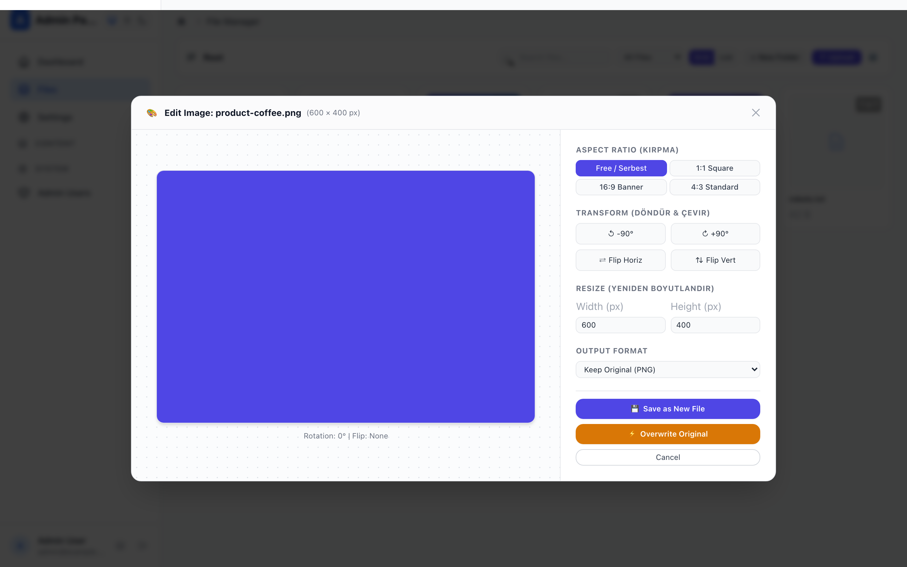
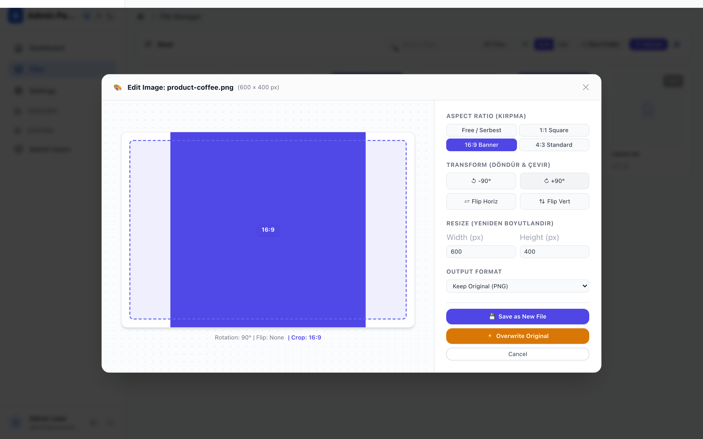
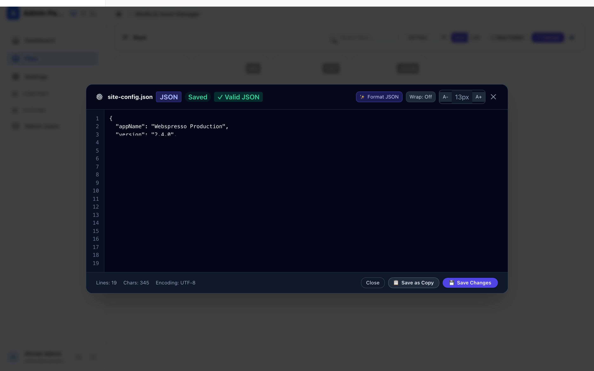
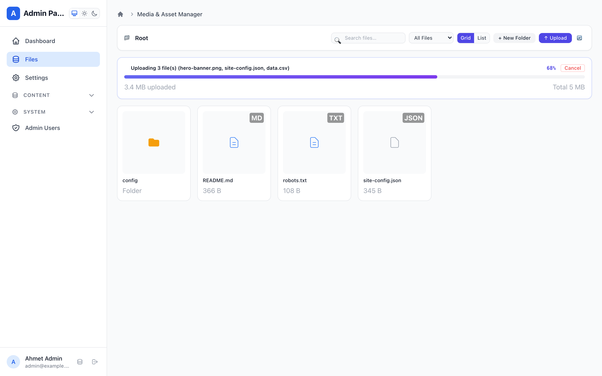
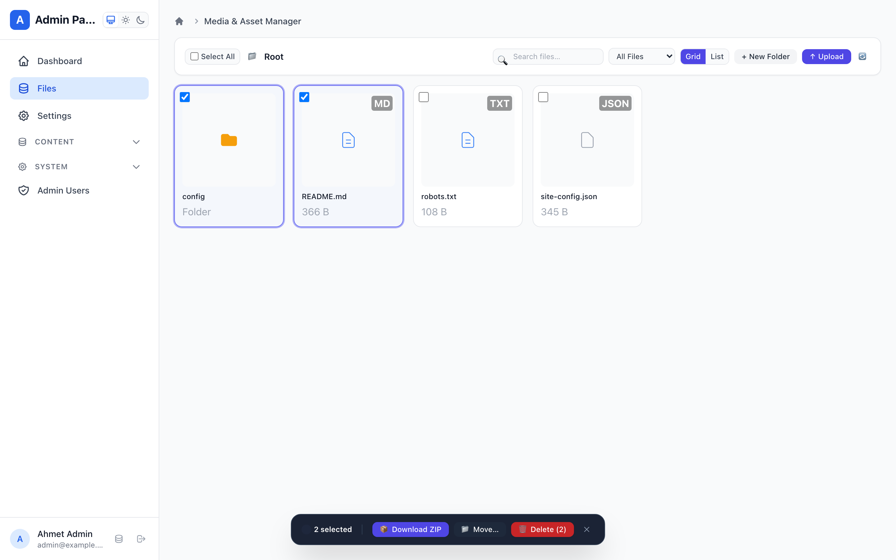
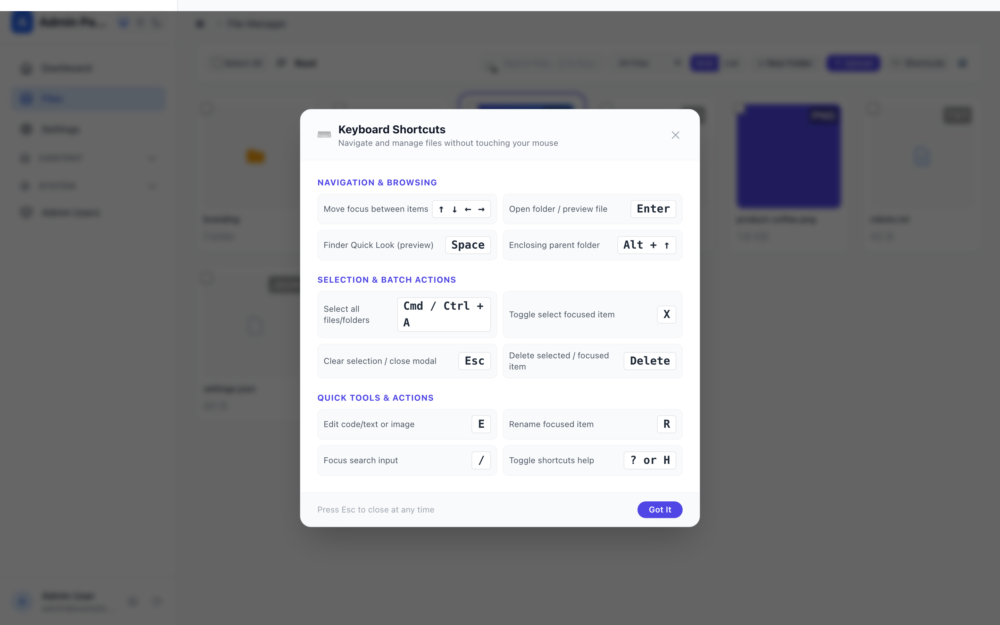
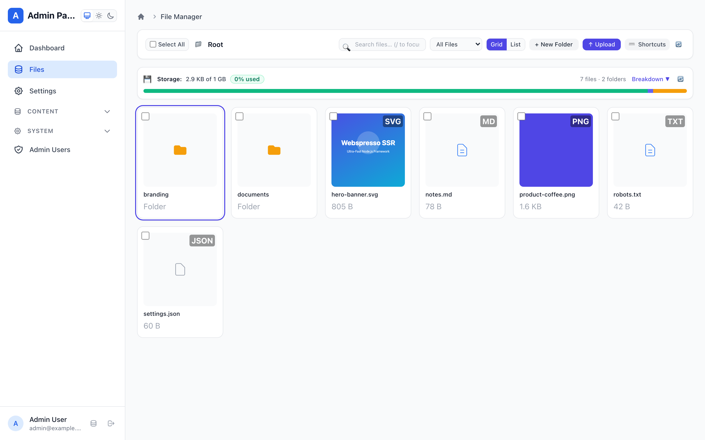
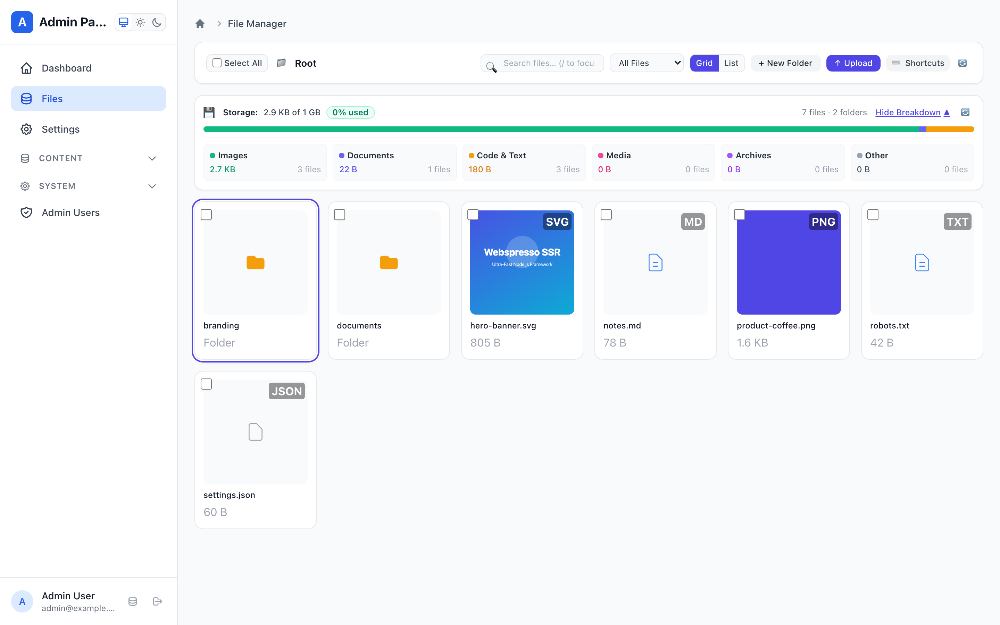

# File Manager & Media Library Guide

Webspresso provides an enterprise-ready, zero-external-dependency **File Manager & Media Library** (`fileManagerPlugin`) integrated natively into the Mithril.js Admin Panel SPA at `/_admin#!/files` and accessible via programmatic services.

---

## 1. Quick Setup & Configuration

Register `fileManagerPlugin` inside `createApp({ plugins: [...] })`:

```javascript
const { createApp, createDatabase, adminPanelPlugin, fileManagerPlugin } = require('webspresso');

const db = createDatabase(require('./webspresso.db'));

const { app } = createApp({
  db,
  plugins: [
    adminPanelPlugin({ db }),
    fileManagerPlugin({
      baseDir: './public/uploads',          // Root storage folder on disk
      publicBasePath: '/uploads',           // Public HTTP URL prefix
      pageTitle: 'Media & File Library',    // Admin sidebar label
      maxUploadBytes: 25 * 1024 * 1024,     // Max per-file upload size (25 MB)
      maxTotalStorageBytes: 1024 * 1024 * 1024, // Storage quota limit (1 GB)
      storageBreakdown: true,               // Enable 6-category breakdown
      lazy: false,                          // JIT hydration for ultra-fast boot
    }),
  ],
});
```

### Plugin Configuration Options

| Option | Type | Default | Description |
| :--- | :--- | :--- | :--- |
| `baseDir` | `string` | `'./public/uploads'` | Absolute or relative filesystem directory where files are stored. |
| `publicBasePath` | `string` | `'/uploads'` | Public URL path prefix mapped to stored assets. |
| `apiPrefix` | `string` | `'/files'` | Admin API subpath (mounted at `/_admin/api/files`). |
| `pageTitle` | `string` | `'File Manager'` | Display title in Admin navigation sidebar. |
| `icon` | `string` | `'folder'` | Admin sidebar icon. |
| `category` | `string` | `'Media'` | Admin sidebar category group. |
| `maxUploadBytes` | `number` | `10485760` (10 MB) | Maximum size allowed for individual file uploads. |
| `maxTotalStorageBytes` | `number` | `1073741824` (1 GB) | Storage quota ceiling for disk warning indicators. |
| `storageBreakdown` | `boolean` | `true` | Computes extension categories (Images, Docs, Code, Media, Archives). |
| `allowedExtensions` | `string[]` | `null` (All safe) | Whitelist of allowed extensions (e.g. `['.png', '.jpg', '.pdf']`). |
| `allowedMimeTypes` | `string[]` | `null` (All safe) | Whitelist of allowed MIME types. |
| `includePage` | `boolean` | `true` | Whether to mount the full SPA File Manager page in Admin. |
| `lazy` | `boolean` | `false` | Defers plugin module hydration until first route invocation. |

---

## 2. Visual Features & User Experience

### 🖼️ In-Browser Image Transformation Suite
Edit, crop, rotate, and optimize images directly in the browser using HTML5 Canvas without installing Sharp or ImageMagick on the server:
- **Aspect Ratio Crop Presets:** `1:1` (Square Avatar), `16:9` (Banner/Hero), `4:3` (Standard Card), or `Free` crop.
- **Rotation & Flip:** Incremental 90° clockwise rotation and horizontal/vertical mirroring.
- **Dimension Scaling:** Maintain aspect ratio while resizing target pixel widths/heights.
- **Modern WebP Export:** Save as optimized WebP or maintain original format, either overwriting the original file or saving as a new copy.


*Fig 1: Aspect ratio crop presets and interactive dimension controls.*


*Fig 2: 90° rotated and cropped image with live preview.*

---

### 📝 Syntax-Aware Text & Code Editor
Edit configuration files, markdown posts, and code scripts directly in Admin without downloading and re-uploading:
- **Line Numbers Gutter:** Clean numbered gutter synced with editor scroll.
- **JSON Auto-Format & Validation:** One-click JSON prettifier and syntax validator.
- **Syntax Extension Detection:** Automatic badge indicators for `.js`, `.json`, `.css`, `.html`, `.md`, `.env`, `.yml`.
- **Unsaved Changes Warning:** Prompts user before closing if changes are dirty.


*Fig 3: In-browser code editor with line gutter, JSON formatting, and quick copy.*

---

### 📤 Full-Surface Drag-and-Drop & Upload Progress
- **Backdrop-Blur Dropzone:** Dragging files over the File Manager triggers a floating dropzone overlay with animated dashed borders.
- **Real-Time Progress Bar:** Native XHR `progress` event tracking showing uploaded byte counts, total size, and percentage.
- **Cancellation:** Abort controller support to safely cancel uploads in-flight.


*Fig 4: Real-time progress bar with byte counter and abort support.*

---

### 📦 Multi-Selection & Batch Operations
Manage bulk assets efficiently in both Grid and List views:
- **Checkbox Multi-Select:** Select individual items or toggle **Select All** across the active folder.
- **Zero-Dependency PKWARE ZIP Download:** Uses Node.js native `zlib.deflateRawSync` and PKWARE binary headers to package selected files into a `.zip` archive on-the-fly.
- **Batch Move:** Move multiple files to any destination subfolder with safe path validation.
- **Batch Delete:** Confirmed deletion of multiple selected assets in a single request.


*Fig 5: Floating batch action bar showing ZIP download, move, and delete actions.*

---

### ⌨️ Keyboard Shortcuts & Rapid Navigation
Power users can navigate directories at blazing speed without touching the mouse:
- **Arrow Keys (`←`, `↑`, `→`, `↓`):** Move active focus with high-contrast ring highlighting.
- **`Space`:** macOS Finder-style Quick Look preview toggle.
- **`Enter`:** Open selected folder or trigger file preview.
- **`Cmd+A` / `Ctrl+A`:** Select all items in current directory.
- **`X`:** Toggle checkbox selection on focused item.
- **`R` / `E` / `Delete`:** Inline rename, edit, or delete focused asset.
- **`/`:** Instantly focus search bar.
- **`?` or `H`:** Display keyboard shortcuts cheatsheet modal.


*Fig 6: Categorized keyboard shortcuts cheatsheet modal.*

---

### 📊 Storage Usage & Quota Visualizer
Monitor disk space consumption with zero database overhead:
- **Dynamic Quota Progress Bar:** Multi-colored visual bar with status badges (Emerald < 75%, Amber 75-90%, Red > 90%).
- **6-Category Breakdown:** Automatic classification into Images (`#10b981`), Documents (`#6366f1`), Code (`#f59e0b`), Media (`#ec4899`), Archives (`#8b5cf6`), and Other (`#94a3b8`).
- **15-Second In-Memory TTL Cache:** Disk scan results are cached to guarantee instant response times and invalidated automatically upon any file write/delete/rename operation.
- **On-Demand Refresh:** Manual reload button (`🔄`) to force an immediate disk re-scan.


*Fig 7: Storage usage meter with quota limit and percentage badge.*


*Fig 8: Collapsible 6-category file type and byte breakdown.*

---

## 3. Form Field Integration: Modal Asset Picker

Integrate the File Manager directly into your ORM Model forms using `zdb.file()`:

```javascript
// models/Article.js
const { defineModel, zdb } = require('webspresso');

module.exports = defineModel({
  name: 'Article',
  table: 'articles',
  schema: {
    title: zdb.string().min(1),
    coverImage: zdb.file({
      allowedExtensions: ['.png', '.jpg', '.webp'],
      maxSize: '5mb',
      admin: {
        picker: true, // Enables "Choose from Media Library" modal button
      },
    }),
  },
});
```

When editing records in the Admin Panel, the `FileUploadField` displays a **"Choose from Media Library"** button that opens a modal file browser to select existing assets.

---

## 4. Built-in Services API

Access the File Manager programmatically in your services, jobs, or API routes:

```javascript
// Inside a service or API handler:
const stats = await ctx.service('fileManager.getStorageStats', { refresh: false });
console.log(`Total usage: ${stats.formattedTotalBytes} of ${stats.formattedQuota}`);

// List files in a directory
const { items, currentDir } = await ctx.service('fileManager.list', { dir: 'avatars' });

// Create a safe subfolder
await ctx.service('fileManager.mkdir', { dir: '', folderName: 'invoices-2026' });

// Generate native PKWARE ZIP archive
const zipBuffer = await ctx.service('fileManager.createZip', {
  paths: ['avatars/user-1.png', 'avatars/user-2.png'],
});
```

---

## 5. Admin REST API Reference

All endpoints are authenticated with Admin staff session guards:

| Endpoint | Method | Payload / Query | Description |
| :--- | :--- | :--- | :--- |
| `/_admin/api/files` | `GET` | `?dir=...` | List items and storage stats in directory. |
| `/_admin/api/files/storage-stats` | `GET` | `?refresh=true` | Fetch detailed storage and category breakdown. |
| `/_admin/api/files/upload` | `POST` | `multipart/form-data` | Upload one or multiple files. |
| `/_admin/api/files/mkdir` | `POST` | `{ dir, folderName }` | Create subfolder. |
| `/_admin/api/files/rename` | `POST` | `{ oldPath, newName }` | Rename item. |
| `/_admin/api/files/delete` | `DELETE` | `{ path }` | Delete file or directory. |
| `/_admin/api/files/move` | `POST` | `{ sourcePath, targetDir }` | Move single item. |
| `/_admin/api/files/batch-move` | `POST` | `{ paths: [], targetDir }` | Move multiple items. |
| `/_admin/api/files/batch-delete` | `POST` | `{ paths: [] }` | Delete multiple items. |
| `/_admin/api/files/download-zip` | `POST` / `GET` | `{ paths: [] }` | Download selected files as PKWARE ZIP archive. |
| `/_admin/api/files/content` | `GET` | `?path=...` | Get text content for code editor. |
| `/_admin/api/files/save-content` | `POST` | `{ path, content }` | Save updated text content. |
| `/_admin/api/files/save-image` | `POST` | `{ path, dataUrl, overwrite, newName }` | Save transformed canvas image. |
