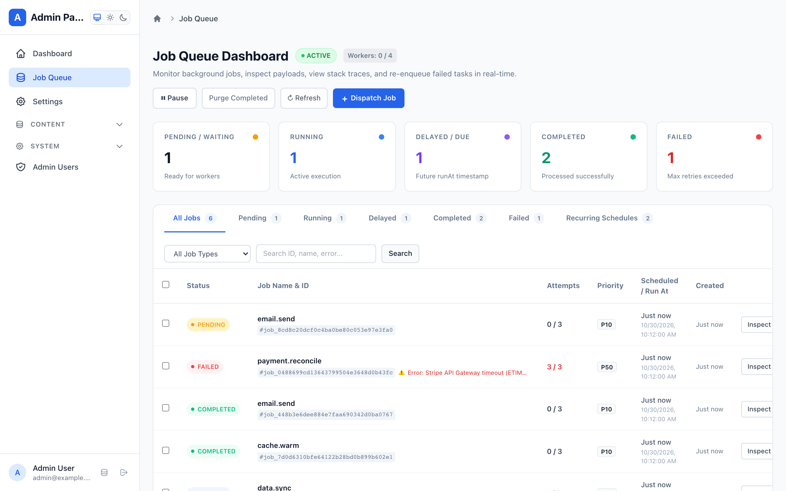
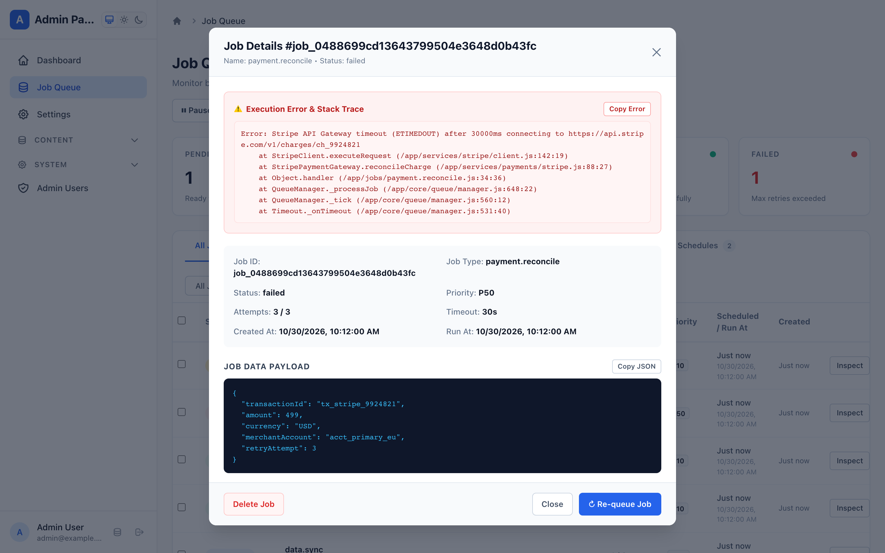
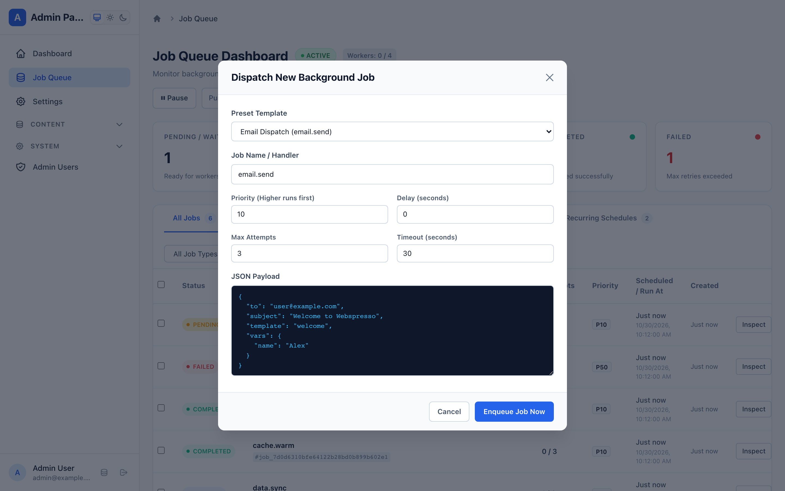

# Background Job Queue & Worker Engine Guide

Webspresso features an enterprise-grade **Background Job Queue and Worker Engine** (`plugins/queue/` and `core/queue/`) designed for offloading time-consuming operations—such as sending transactional emails, compiling PDF reports, warming caches, synchronizing third-party APIs, and running recurring cron tasks—without blocking HTTP request lifecycles.

It includes native **Memory**, **Database (Knex/SQL)**, **Distributed Redis**, **Edge WaitUntil**, and **Cloudflare Queues** adapters, an interactive **Mithril.js Admin Dashboard SPA** mounted at `/_admin#!/queue`, automated exponential backoff retries, error stack trace inspection, and built-in framework services.

---

## 1. Quick Setup & Configuration

Register `queuePlugin` inside `createApp({ plugins: [...] })`:

```javascript
const { createApp, createDatabase, adminPanelPlugin, queuePlugin } = require('webspresso');

const db = createDatabase(require('./webspresso.db'));

const { app } = createApp({
  db,
  plugins: [
    adminPanelPlugin({ db }),
    queuePlugin({
      adapter: 'database', // 'memory' | 'database' | 'redis' | 'wait-until' | 'cloudflare'
      db,                  // Knex instance for database adapter
      concurrency: 4,      // Maximum concurrent active worker jobs
      pollInterval: 500,   // Polling interval in ms when idle
      autoStart: true,     // Start worker processing loop immediately
      retentionDays: 7,    // Prune completed jobs older than 7 days
    }),
  ],
});
```

### Plugin Configuration Options

| Option | Type | Default | Description |
| :--- | :--- | :--- | :--- |
| `adapter` | `'memory' \| 'database' \| 'redis' \| 'wait-until' \| 'cloudflare'` | `'memory'` | Storage and dispatch backend adapter. |
| `db` | `Object` | `ctx.db` | Knex/ORM instance when using `'database'` adapter. |
| `redisClient` | `Object` | `null` | Redis/ioredis client instance when using `'redis'` adapter. |
| `tableName` | `string` | `'webspresso_jobs'` | Database table name for database-backed queue. |
| `concurrency` | `number` | `2` | Maximum concurrent jobs running simultaneously per instance. |
| `pollInterval` | `number` | `500` | Polling tick interval in milliseconds when idle. |
| `jobsDir` | `string` | `<cwd>/jobs` | Directory for file-based auto-discovered job handlers. |
| `autoStart` | `boolean` | `true` | Start processing queue loop automatically on boot. |
| `retentionDays` | `number` | `7` | Retention period in days for pruning completed and failed jobs. |
| `adminTitle` | `string` | `'Job Queue'` | Module navigation title inside Admin Panel SPA. |
| `adminApiPrefix` | `string` | `'/queue'` | REST API prefix mounted under `/_admin/api`. |

---

## 2. Interactive Admin Management SPA

When `adminPanelPlugin` is present, `queuePlugin` automatically registers a first-class management interface inside the Webspresso Admin Panel at `/_admin#!/queue`.

### 📊 Real-Time KPI Metrics & Status Filters

The dashboard banner provides immediate visibility into queue health:
- **Pending / Waiting:** Jobs ready to be claimed by available workers.
- **Running / Active:** Currently executing jobs across worker slots.
- **Delayed / Due:** Jobs scheduled for future execution with a configured delay or timestamp.
- **Completed:** Jobs that finished execution successfully.
- **Failed:** Jobs that encountered unrecoverable exceptions or exceeded `maxAttempts`.
- **Status Tabs & Search:** Filter jobs by status (`All`, `Pending`, `Running`, `Delayed`, `Completed`, `Failed`), filter by registered job type, or perform instant text searches across Job IDs, payloads, and error messages.


*Fig 1: Job Queue Dashboard in Webspresso Admin with live KPI metric cards, status filters, and worker status.*

---

### 🔍 Job Details & Error Traceback Inspector

Clicking **Inspect** on any job opens the comprehensive `JobDetailModal`:
- **Execution Error & Stack Trace:** Prominently highlights error messages and complete multiline stack traces with a 1-click **Copy Error** button for rapid troubleshooting.
- **Metadata Key-Value Grid:** Displays Job ID, Job Type, Status, Priority, Attempts / Max Attempts, Timeout, Created At, and Run At.
- **Job Data Payload:** Syntax-highlighted JSON viewer with a **Copy JSON** button.
- **Result Viewer:** Output returned by the worker function if successfully completed.
- **1-Click Retry / Re-queue:** Instantly reset attempts and re-enqueue the job for immediate re-execution.


*Fig 2: Job Detail Modal showing execution stack trace, metadata grid, and formatted JSON payload.*

---

### 🚀 Manual Job Dispatch Modal

Staff can enqueue ad-hoc jobs on-demand via the **+ Dispatch Job** modal:
- **Preset Templates:** Quick starters for `email.send`, `report.generate`, `cache.warm`, `data.sync`, and `custom`.
- **Priority & Delay:** Configure priority (1 to 100, higher runs first) and delay in seconds.
- **Attempts & Timeout:** Customize max retries and per-job timeout ceilings.
- **JSON Payload Editor:** Interactive JSON editor with format validation.


*Fig 3: Manual Job Dispatch Modal allowing staff to enqueue ad-hoc jobs with parameters and JSON payload.*

---

## 3. Defining & Dispatching Jobs in Code

### File-Based Job Workers (`jobs/`)

Place worker scripts inside `jobs/`. Webspresso automatically discovers and registers them:

```javascript
// jobs/email/welcome.js
module.exports = {
  options: {
    attempts: 3,
    priority: 20,
    timeout: '15s',
    backoff: { type: 'exponential', delay: 1000 },
  },
  handler: async (job, ctx) => {
    const { to, name } = job.data;
    job.progress(20, 'Compiling template');
    
    // Perform async task
    await ctx.service('mail.send', {
      to,
      subject: `Welcome ${name}!`,
      template: 'welcome',
    });

    job.progress(100, 'Delivered');
    return { delivered: true, recipient: to };
  },
};
```

### Recurring Cron Tasks (`*.cron.js`)

Suffix files with `.cron.js` to create scheduled background tasks:

```javascript
// jobs/reports/nightly.cron.js
module.exports = {
  cron: '0 2 * * *', // Every night at 02:00 AM
  options: { priority: 5 },
  handler: async (job) => {
    // Generate nightly reports
    return { status: 'ok' };
  },
};
```

### Dispatching from Request Handlers & Loaders

Access the queue engine via `req.queue` in API routes or `ctx.queue` in services:

```javascript
// pages/api/auth/register.post.js
const { defineApi } = require('webspresso');

module.exports = defineApi({
  handler: async (req, res) => {
    const user = await req.db.getRepository('User').create(req.input.body);

    // Enqueue welcome email asynchronously
    await req.queue.dispatch('email.welcome', {
      to: user.email,
      name: user.name,
    }, { priority: 20, delay: '5s' });

    return res.status(201).json(user);
  },
});
```

---

## 4. Built-in Framework Services

The queue engine registers official built-in services in `ctx.serviceRegistry`:

| Service Name | Input Parameters | Description |
| :--- | :--- | :--- |
| `queue.stats` | *none* | Fetch real-time queue metrics and worker counts. |
| `queue.list` | `{ status, name, search, page, limit, sortBy, sortOrder }` | List paginated jobs with filters. |
| `queue.get` | `{ id }` | Retrieve job details by ID. |
| `queue.retry` | `{ id, delayMs, resetAttempts }` | Re-queue a failed or completed job. |
| `queue.bulk-retry` | `{ ids: array, delayMs, resetAttempts }` | Bulk re-queue multiple jobs by ID. |
| `queue.cancel` | `{ id }` | Cancel and delete a job from the queue. |
| `queue.purge` | `{ status: ['completed', 'failed'] }` | Prune completed or failed jobs immediately. |
| `queue.dispatch` | `{ name, data, delay, priority, attempts, timeout }` | Enqueue a new background job. |
| `queue.pause` | *none* | Pause worker processing loop. |
| `queue.resume` | *none* | Resume worker processing loop. |

```javascript
// Example: Triggering from a service or CLI script
const stats = await ctx.service('queue.stats');
console.log(`Active workers: ${stats.activeWorkers}/${stats.concurrency}`);

await ctx.service('queue.retry', { id: 'job_48821' });
```
