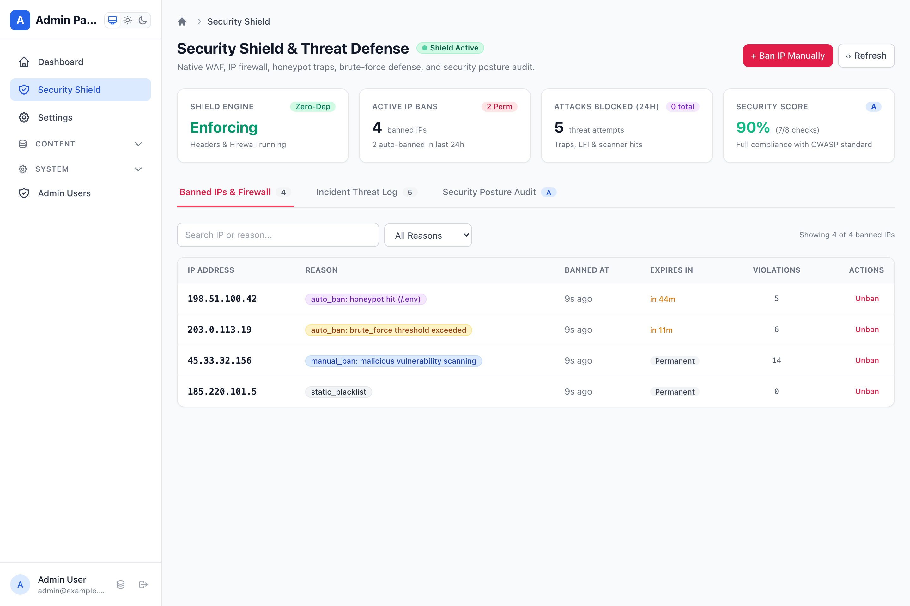
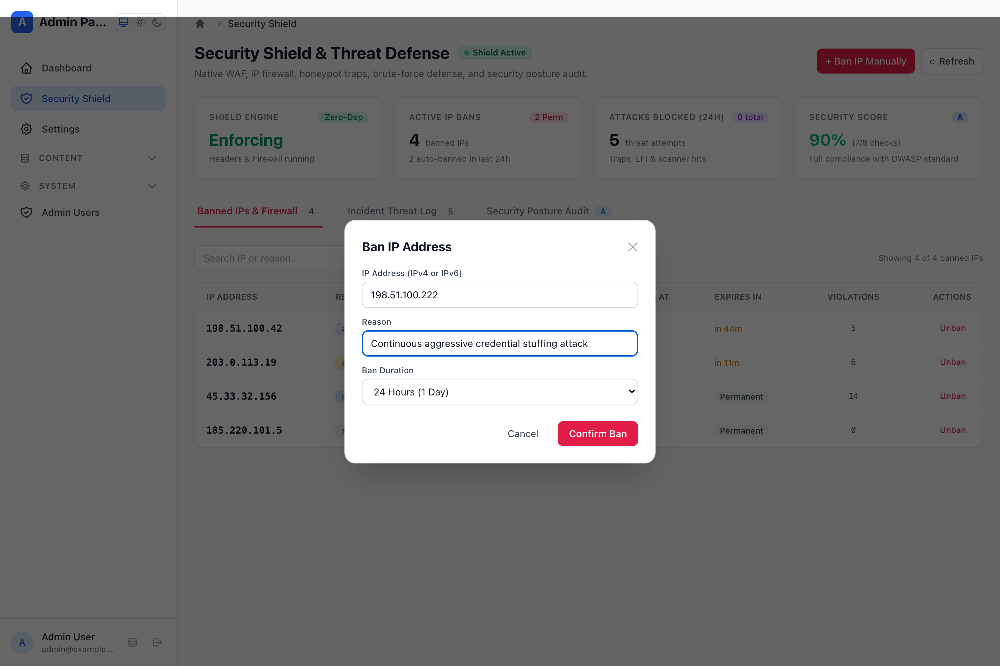
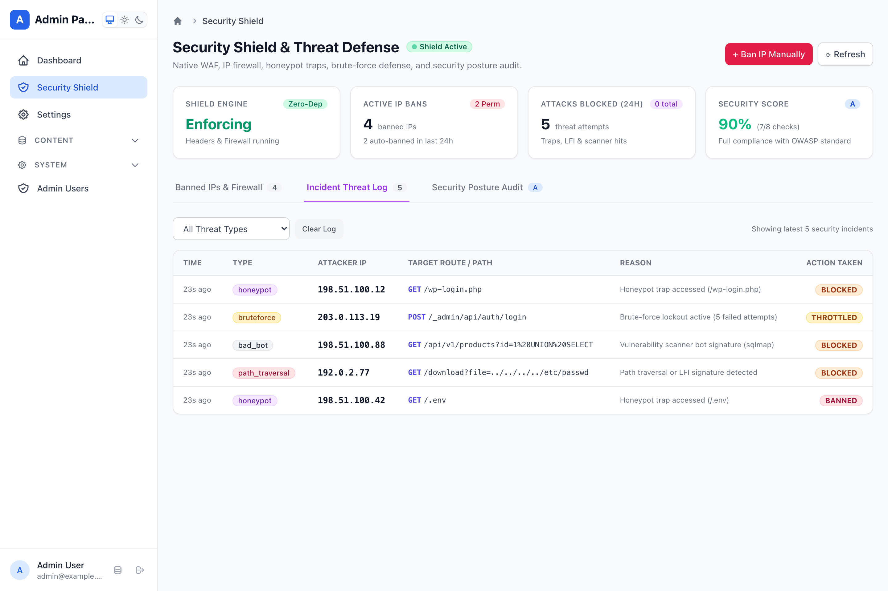
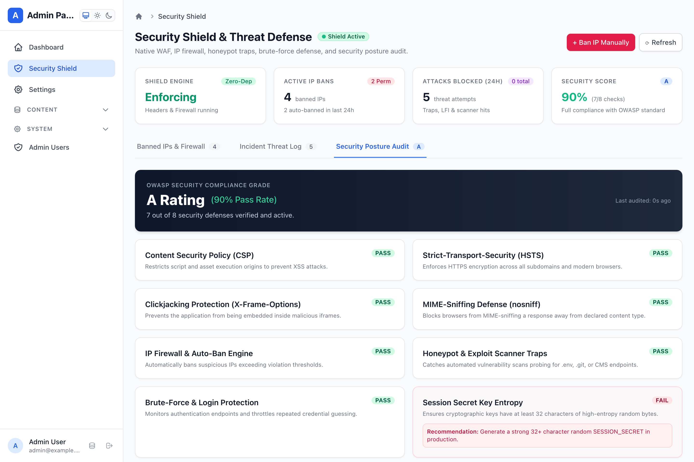

# Enterprise Security Shield & Threat Defense

Webspresso provides an enterprise-grade, zero-dependency **Security Shield Plugin** (`securityPlugin`) featuring a native WAF, HTTP security headers engine (Helmet alternative), intelligent IP firewall & auto-ban, honeypot traps, LFI/path traversal protection, brute-force defense, and a Mithril.js Admin Panel Security Cockpit.



---

## 🚀 Key Features

- **Zero External Dependencies:** Built 100% on native Node.js standard modules (`crypto`, `net`, `events`). No `helmet`, no heavy third-party rate limiters or parsers.
- **Native Security Headers (Helmet Alternative):** Complete CSP, HSTS, `X-Frame-Options`, `X-Content-Type-Options: nosniff`, `Referrer-Policy`, and `Permissions-Policy`.
- **IP Firewall & CIDR Subnet Matching:** Whitelist and blacklist with support for exact IPs and CIDR ranges (`192.168.1.0/24`, `10.0.0.0/8`).
- **Sliding Auto-Ban Engine:** Automatically bans IPs that exceed violation thresholds (e.g. 5 violations in 5 minutes) for a configurable duration.
- **Honeypot Traps & Bot Scanners:** Traps automated vulnerability bots probing for `/.env`, `/.git`, `/wp-admin`, `/phpmyadmin` and blocks tools like `sqlmap`, `nikto`, `acunetix`.
- **Path Traversal & LFI Defense:** Rejects requests containing directory traversal sequences (`../`, `%2e%2e`, `/etc/passwd`).
- **Brute-Force & Credential Stuffing Guard:** Monitors authentication routes, throttles repeated failures, and applies progressive delays and temporary HTTP 429 lockouts.
- **Mithril.js Admin Security Cockpit (`/_admin#!/security`):** Live KPI cards, Banned IPs table with search and 1-click unban, interactive Ban IP modal, incident feed, and OWASP compliance audit.
- **Framework Built-in Services:** Programmatically ban, unban, inspect stats, and audit system posture via `ctx.service('security.*')`.

---

## 📦 Installation & Quick Start

The `securityPlugin` is built into Webspresso:

```javascript
const { createApp } = require('webspresso');
const { securityPlugin, adminPanelPlugin } = require('webspresso/plugins');

const app = createApp({
  plugins: [
    securityPlugin({
      headers: {
        csp: true,
        hsts: true,
        frameGuard: 'SAMEORIGIN',
        noSniff: true,
        referrerPolicy: 'strict-origin-when-cross-origin',
      },
      firewall: {
        whitelist: ['127.0.0.1'],
        autoBan: {
          enabled: true,
          threshold: 5,        // 5 violations
          window: '5m',        // within 5 minutes
          duration: '1h',      // ban for 1 hour
        },
      },
      honeypot: {
        paths: ['/.env', '/wp-admin', '/phpmyadmin', '/.git'],
        detectTraversal: true,
        blockBadBots: true,
      },
      bruteForce: {
        routes: ['/api/auth/login', '/_admin/api/auth/login'],
        maxAttempts: 5,
        lockout: '15m',
      },
      adminPanel: true,        // Mounts at /_admin#!/security
    }),
    adminPanelPlugin({ db }),
  ],
});
```

---

## 🖥️ Admin Panel Security Cockpit

### 1. Banned IPs & Firewall Manager
Inspect all currently active and permanent IP bans with reason badges, relative timestamps, remaining duration, violation counts, and 1-click unban actions.



### 2. Live Incident Threat Feed
Examine real-time threat intelligence including honeypot hits, directory traversal attempts, malicious vulnerability scanners, and brute-force lockouts.



### 3. Security Posture Audit & Checklist
Automated evaluation of your production security compliance against OWASP standards with letter grading (A+, A, B, C, F) and actionable remediation steps.



---

## ⚙️ Built-in Framework Services

You can invoke security actions directly from services, SSR page loaders, or API routes via `ctx.service` or `req.service`:

```javascript
// Ban an offending IP
await req.service('security.ban', {
  ip: '198.51.100.42',
  reason: 'Abusive API scraping',
  duration: '24h',
});

// Check if an IP is currently banned
const banStatus = await req.service('security.check-ip', { ip: '198.51.100.42' });
if (banStatus.banned) {
  console.log(`IP is banned until ${banStatus.expiresAt} for ${banStatus.reason}`);
}

// Unban an IP
await req.service('security.unban', { ip: '198.51.100.42' });

// Get live security statistics
const stats = await req.service('security.stats');
console.log(`Active bans: ${stats.activeBans}, Grade: ${stats.securityGrade}`);
```

---

## 🛡️ Programmatic API

Access the firewall and security manager directly from the plugin or request context:

```javascript
// Inside API routes:
const clientIp = req.ip;
const isBanned = req.security.isBanned(clientIp);

// Or via plugin API:
const secApi = app.plugins.security?.api;
secApi.ban('203.0.113.10', { reason: 'manual_ban', duration: '7d' });
secApi.unban('203.0.113.10');
```
