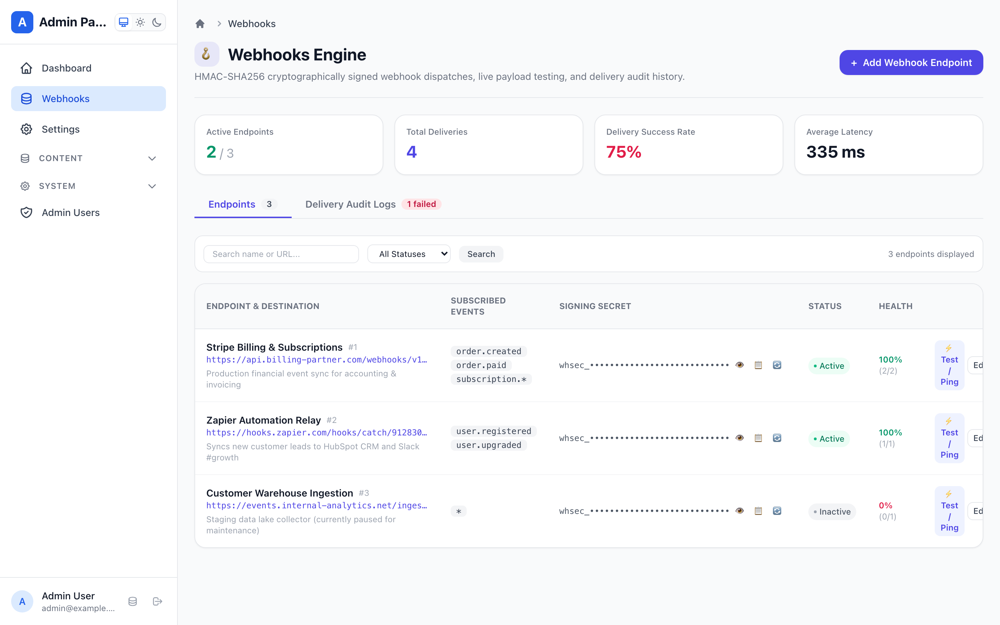
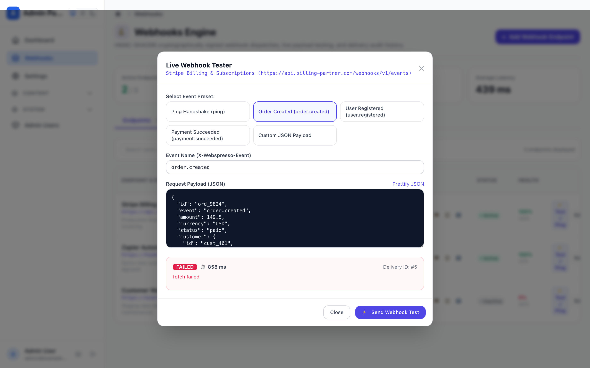
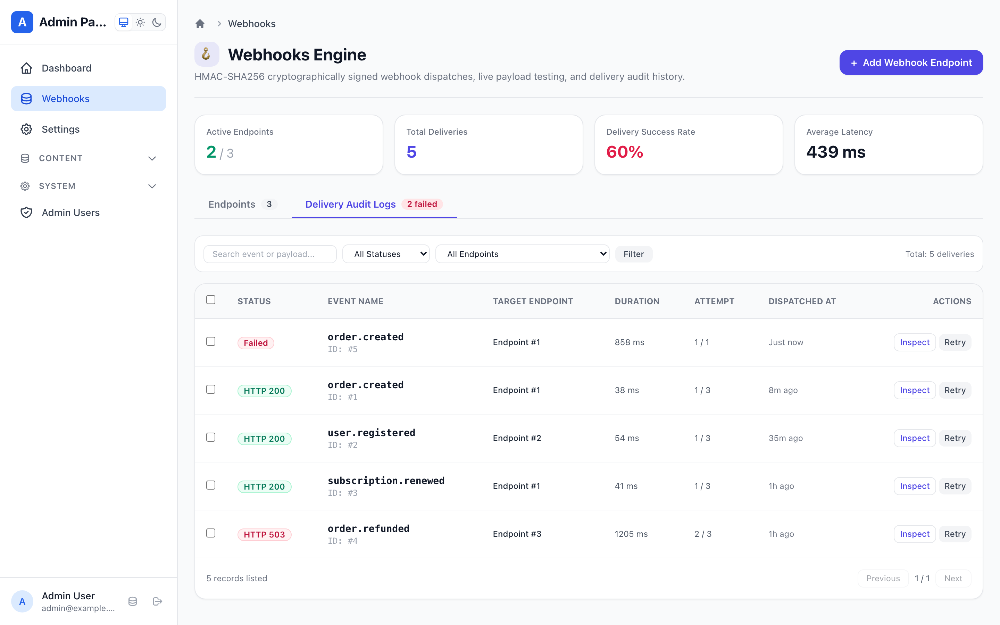
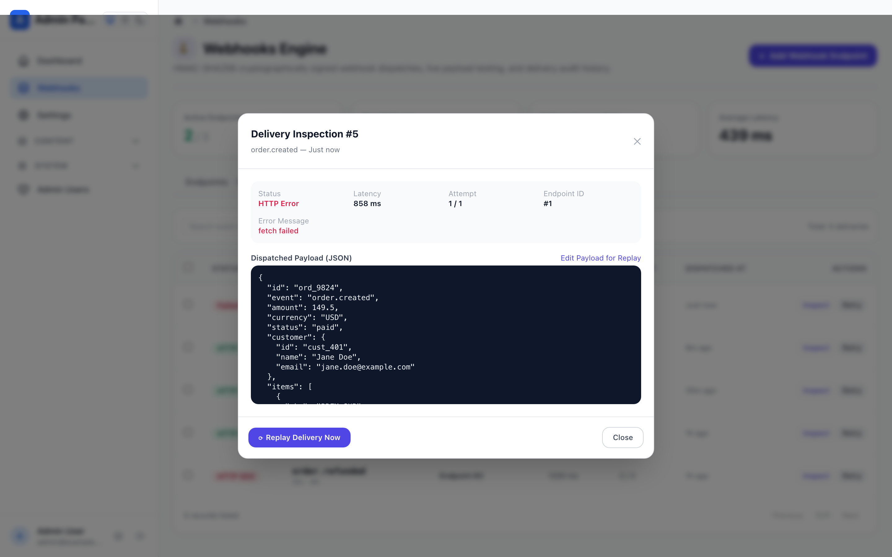
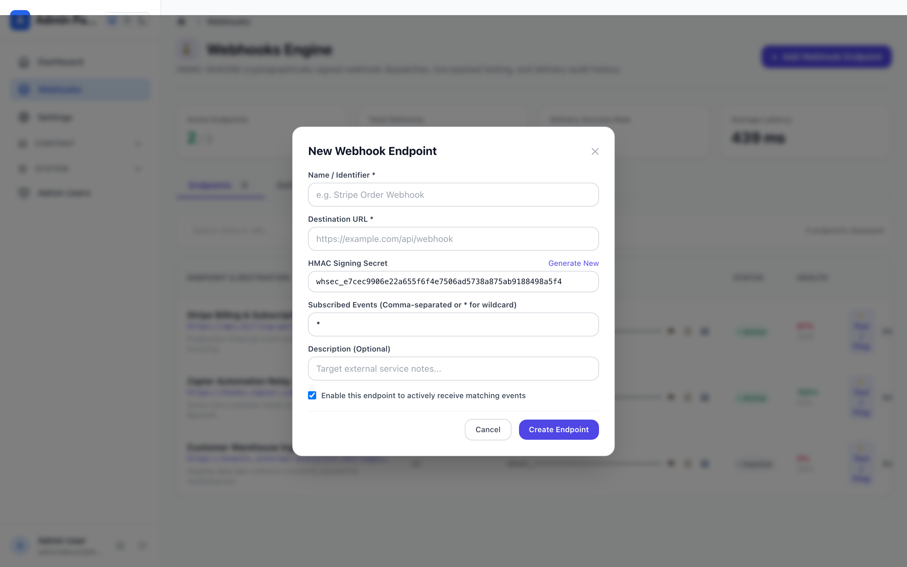

# Outgoing Webhooks Engine & Event Dispatcher Guide

Webspresso includes a production-grade, zero-external-dependency **Outgoing Webhooks Engine** (`webhooksPlugin`). It provides secure HMAC-SHA256 signature generation, wildcard event filtering (`*`, `order.*`), automatic exponential backoff retries, optional background queue worker execution (`core/queue`), and an enterprise Mithril.js Admin Panel SPA mounted at `/_admin#!/webhooks`.

---

## 1. Quick Setup & Configuration

Register `webhooksPlugin` inside `createApp({ plugins: [...] })`:

```javascript
const { createApp, createDatabase, adminPanelPlugin, webhooksPlugin } = require('webspresso');

const db = createDatabase(require('./webspresso.db'));

const { app } = createApp({
  db,
  plugins: [
    adminPanelPlugin({ db }),
    webhooksPlugin({
      db,
      endpointsTable: 'webhook_endpoints',
      deliveriesTable: 'webhook_deliveries',
      maxAttempts: 3,
      backoffBaseMs: 1000,
      timeoutMs: 10000,
      wrapPayload: true,
      includeDefaultPage: true,
      pageTitle: 'Webhooks',
    }),
  ],
});
```

### Plugin Configuration Options

| Option | Type | Default | Description |
| :--- | :--- | :--- | :--- |
| `db` | `Object` | `null` | Knex database instance for endpoints & delivery logs. |
| `endpointsTable` | `string` | `'webhook_endpoints'` | Table name storing registered subscriber URLs & secrets. |
| `deliveriesTable` | `string` | `'webhook_deliveries'` | Table name storing delivery attempt logs and responses. |
| `maxAttempts` | `number` | `3` | Maximum automatic delivery attempts per dispatch. |
| `backoffBaseMs` | `number` | `1000` | Base delay for exponential backoff (`delay = base * 2^(attempt-1)`). |
| `timeoutMs` | `number` | `10000` | HTTP request timeout in milliseconds. |
| `wrapPayload` | `boolean` | `true` | Envelop payload into standard structure (`{ id, event, data, timestamp }`). |
| `queue` | `Object` | `null` | Webspresso QueueManager instance (`core/queue`) for async worker processing. |
| `apiPrefix` | `string` | `'/webhooks'` | Route prefix for Webhooks Admin API mounted under `/_admin/api`. |
| `includeDefaultPage` | `boolean` | `true` | Mount Webhooks Management UI in Admin Panel at `/_admin#!/webhooks`. |
| `pageTitle` | `string` | `'Webhooks'` | Sidebar menu title in Admin Panel. |
| `menuOrder` | `number` | `92` | Sidebar menu display order. |

---

## 2. Admin Management SPA & Visual Features

Mounted inside the Admin Panel at `/_admin#!/webhooks`, the management suite provides dedicated workspaces for configuration, live testing, and delivery audits:

### 📊 Endpoints Dashboard & Global Health Metrics
Monitor the real-time status of all external subscriber endpoints:
- **Global Metrics Banner:** Instant KPI telemetry showing Active / Total endpoints, Total Dispatched Deliveries, Delivery Success Rate %, and Average Request Latency in milliseconds.
- **Masked Signing Secrets:** Secrets are masked by default (`whsec_••••••••••••`) with 1-click reveal, copy to clipboard, and instant rotation.
- **Event Subscriptions Badge List:** Clear visual badges displaying topic subscriptions (`*`, `order.created`, `subscription.*`).
- **Endpoint Quick Actions:** Toggle active/inactive state, edit URL and custom headers, delete, or trigger live test dispatches.


*Fig 1: Webhook endpoints overview with real-time KPI metrics banner, search filters, and masked HMAC secrets.*

---

### ⚡ Live Payload & Ping Tester (Interactive Modal)
Test subscriber webhook receivers live from your browser without generating mock transactions:
- **Event Presets:** 1-click presets for common domain events (`ping`, `order.created`, `user.registered`, `payment.succeeded`) or custom events.
- **Editable JSON Payload Sandbox:** Live syntax editor with validation before dispatching to destination endpoints.
- **Full Response Diagnostics:** Inspect HTTP status code badges, execution latency, response headers, request signature headers (`x-webhook-signature`), and raw response body.


*Fig 2: Interactive live tester showing preset picker, editable JSON payload, and full HTTP response diagnostics.*

---

### 📋 Delivery Audit Logs & Bulk Actions
Inspect and debug every outbound webhook attempt:
- **Search & Status Filtering:** Filter delivery logs by event topic, endpoint, or HTTP outcome (`All`, `Success`, `Failed`).
- **Multi-Select Bulk Retry:** Select multiple failed deliveries using row checkboxes and trigger batch re-dispatch with the floating bulk action bar.
- **Attempt History & Latency:** View exact dispatch timestamps, latency in ms, attempt count (`1 of 3`), and error snippets.


*Fig 3: Delivery audit logs table with status badges, latency metrics, and floating bulk retry bar.*

---

### 🔍 Delivery Inspection & Replay Engine
Deep-dive into individual delivery records and replay them on demand:
- **Comprehensive Failure Diagnostics:** View exact network errors, timeout codes, or remote server responses (including HTML error pages).
- **1-Click Retry vs Replay:** Retry original delivery attempt or spawn a new delivery record.
- **Edit-and-Replay Mode:** Modify the outgoing JSON payload in-place before replaying to test edge-case fixes or updated data formats.


*Fig 4: Delivery inspection modal with request payload viewer, response body tabs, and in-place edit-and-replay engine.*

---

### ⚙️ Endpoint Configuration Modal
Register and update subscriber webhook endpoints:
- **Auto-Generated Cryptographic Secret:** Automatically generates high-entropy `whsec_...` secrets using native Node.js crypto.
- **Granular Wildcard Filtering:** Subscribe endpoints to all events (`*`) or specific namespaces (`order.*`, `invoice.paid`).
- **Custom HTTP Headers:** Configure custom headers (e.g. `Authorization`, `X-Partner-Id`) to authenticate with external APIs.


*Fig 5: Endpoint creation modal with secret generator, event multi-select, and custom header support.*

---

## 3. Cryptographic Signature & Verification

Every outbound webhook includes an HMAC-SHA256 signature header ensuring authenticity and payload integrity.

### Standard Webhook Headers

```http
POST /your-webhook-handler HTTP/1.1
Host: api.partner.com
Content-Type: application/json
User-Agent: Webspresso-Webhooks/1.0
x-webhook-id: dlv_9f82a1c03e
x-webhook-event: order.created
x-webhook-timestamp: 1761814800
x-webhook-signature: t=1761814800,v1=5d41402abc4b2a76b9719d911017c592...
```

### Verifying Webhooks on Receiver Side (Node.js Example)

```javascript
const crypto = require('node:crypto');

function verifyWebhook(payloadString, signatureHeader, secret) {
  const parts = signatureHeader.split(',');
  const timestamp = parts.find(p => p.startsWith('t='))?.slice(2);
  const signature = parts.find(p => p.startsWith('v1='))?.slice(3);

  if (!timestamp || !signature) {
    throw new Error('Invalid signature header format');
  }

  // Prevent replay attacks (5-minute tolerance)
  const now = Math.floor(Date.now() / 1000);
  if (Math.abs(now - parseInt(timestamp, 10)) > 300) {
    throw new Error('Webhook timestamp outside acceptable tolerance');
  }

  const signedPayload = `${timestamp}.${payloadString}`;
  const expectedSignature = crypto
    .createHmac('sha256', secret)
    .update(signedPayload)
    .digest('hex');

  const sigBuffer = Buffer.from(signature, 'hex');
  const expectedBuffer = Buffer.from(expectedSignature, 'hex');

  if (sigBuffer.length !== expectedBuffer.length || !crypto.timingSafeEqual(sigBuffer, expectedBuffer)) {
    throw new Error('Webhook signature mismatch');
  }

  return true;
}
```

---

## 4. Built-In Services & Programmatic API

The webhooks plugin registers built-in services within Webspresso's unified Services Layer (`core/services`), allowing seamless consumption from API routes, loaders, and background jobs.

### Registered Services

| Service Name | Description | Input Parameters |
| :--- | :--- | :--- |
| `webhook.dispatch` | Dispatch an event to matching subscribers | `{ event: string, payload: any, headers?: Object }` |
| `webhook.ping` | Send lightweight handshake ping to an endpoint | `{ endpointId: number \| string }` |
| `webhook.test` | Send test payload with custom event to endpoint | `{ endpointId: number \| string, event?: string, payload?: any }` |
| `webhook.retry` | Re-attempt an existing delivery record | `{ deliveryId: number \| string }` |
| `webhook.replay` | Replay delivery with optional modified payload | `{ deliveryId: number \| string, payload?: any, event?: string }` |
| `webhook.rotate-secret` | Rotate signing secret preserving old secret | `{ endpointId: number \| string, newSecret?: string }` |
| `webhook.bulk-retry` | Batch re-attempt multiple failed deliveries | `{ deliveryIds: Array<number \| string> }` |
| `webhook.get-stats` | Compute global endpoint and delivery statistics | `{}` |

### Usage in API Routes & Services

```javascript
// pages/api/orders.post.js
const { defineApi } = require('webspresso');

module.exports = defineApi({
  handler: async (req, res, ctx) => {
    const order = await req.db.getRepository('Order').create(req.input.body);

    // Dispatch webhook event across all registered subscribers
    await ctx.service('webhook.dispatch', {
      event: 'order.created',
      payload: {
        orderId: order.id,
        amount: order.amount,
        customer: order.customer_email,
      },
    });

    return res.status(201).json(order);
  },
});
```

### Direct Programmatic Dispatcher Access

You can also access the dispatcher directly via `req.webhooks` or `app.webhooks`:

```javascript
// Dispatch directly
const deliveries = await req.webhooks.dispatch('user.registered', {
  userId: user.id,
  email: user.email,
});

// Rotate secret with grace period support
const { secret, previousSecret } = await req.webhooks.rotateSecret(endpointId);

// Replay a delivery with modified payload
const replayed = await req.webhooks.replayDelivery(deliveryId, {
  payload: { ...originalPayload, status: 'manual_override' },
});
```

---

## 5. Database Schema & Migration

Generate the required Knex migration using the built-in helper:

```javascript
// migrations/20261030_create_webhooks_tables.js
const { webhooksPlugin } = require('webspresso/plugins/webhooks');

const migration = webhooksPlugin.generateWebhooksMigration('webhook_endpoints', 'webhook_deliveries');

exports.up = migration.up;
exports.down = migration.down;
```

Run migrations via CLI:

```bash
npx webspresso db:migrate
```
